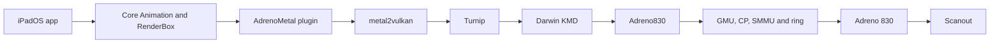

# Adreno830

Start with the [adaptation procedure](/porting/gpu) for board inputs, source changes, build integration and verification order.

Adreno830 implements the A830 (Gen8, chip ID `0x44050001`) kernel GPU interface used by SM8750. It powers the GPU up from a cold boot, programs the GPU SMMU, starts the GMU and the command processor, and manages command submission, memory, fences and frequency. Its SM8750 layer (`platform/sm8750`) supplies GPU power, RPMh votes, SCM calls and SoC information. The board supplies signed firmware, generated device-tree constants, reserved memory and display integration through one structure, `Adreno830Board`.

The user-client ABI is the one Adreno740 publishes: `NativeAdrenoABI.h` v2 is byte-identical and only the `DeviceInfo` values differ. The same AdrenoMetal plugin serves both drivers. The A830 user-space changes are listed under [Build](#build).

The first board is the OnePlus 13T (PKX110) with iPadOS 17.7.11 (21H461). No GPU hardware result is recorded yet.

## Runtime path



1. backboardd finds the `AGXAccelerator` service (an `IOAcceleratorES`) and loads the AdrenoMetal plugin named by its `MetalPluginName` property. The plugin publishes the Metal device and owns the Metal objects, encoders, IOSurfaces, events and fences.
2. metal2vulkan translates AIR to SPIR-V. Turnip compiles SPIR-V through NIR to A830 IR3 and encodes the command streams.
3. The Darwin KMD in Turnip opens the `AGXDeviceUserClient` of Adreno830. Adreno830 owns BOs, GPU addresses, the submission ring, fences and the SMMU context.
4. The GMU applies power and frequency votes. The CP executes the IBs from the ring and writes the fence values.
5. With `sheng-fb-gpu=1`, the plugin copies each composited frame into the scanout buffer through the hand-off methods of the same user client, and NativeMobileDisplay offers and retires the swap. Without it, NativeMobileDisplay copies the frame with the CPU.

## Bring-up

When `pagani-gpu=1`, Stage7Probe calls the board's `pagani_gpu_start()` at the end of the display late probe, and the board calls `adreno830_start()` once, synchronously, before launchd starts. The orchestrator runs these stages in order:

| Stage | Row name | Work |
| --- | --- | --- |
| S0 | `INPUTS` | Board structure, firmware lengths and SHA-256, cmd-db, SMEM socinfo (SoC 618), speed-bin fuse, level tables |
| S1 | `POWER` | Host CX and MX votes, GPU power-up (GDSC, PLL, clocks), optional AOSS QMP message |
| S2 | `SECCX` | SCM `GPU_INIT_REGS`, host CN0 and DDR votes |
| S3 | `SMMU` | SMMU survey, GMU context (CB2), GPU context (CB0), LPAC stream, BO pool, aperture call |
| S4 | `FWMEM` | GMU memory and image, SQE and AQE, ring, memptrs and power-up list |
| S5 | `GMU-HFI` | GMU cold boot, HFI start messages, `OOB_GPU`, GX power confirmation |
| S6 | `CP` | Gen8 hardware init, microcode bases, ring, `CP_ME_INIT` |
| S7 | `ZAP` | ZAP image through PAS 13, secure mode exit |
| S8 | `FENCE` | Fences (GPU interrupt 332 in the design profile), GMU always-on timer, self-test writes |
| S9 | `METAL` | `NativeAdrenoGpu` and the staged `AGXAccelerator` services |
| S10 | `DCVS` | Power state machine, recovery and the DCVS thread |

A failure stops at its stage and records the step, reason code, IOReturn and register. The driver then publishes nothing and the desktop stays on CPU presentation. `pagani-gpu-stop=N` stops after stage N.

The status block `adreno830_status` feeds the BootProgress overlay rows (`pagani-gpu-status`) and, after S9, the registry property `Adreno830Status` of `NativeAdrenoGpu`. Row 0 has one of these forms:

| Row 0 | Meaning |
| --- | --- |
| `GPU S<stage>.<step> <name> FAIL <ioreturn> <register>=<value> r<reason>` | The stage failed |
| `GPU S<stage> <name> STOP ok <ms>ms` | Stopped by `pagani-gpu-stop` after every earlier stage passed |
| `GPU RUN <MHz>M b<busy%> g<level>/b<bus> s<submits> f<faults> h<hangs>` | The driver runs |

Once S0 has accepted the profile, row 0 ends with `p1` (annibale) or `p0` (design) when the row has room. With `pagani-gpu-status=2` the annibale S5 rows also show the TCM words read back (`TCM`), `GENERAL_11` (`G11`) and the RSC status (`RSC`); after a late HFI drain the S5 to S8 rows end with `L<m>/<a>/<e>` (messages, late acknowledgements and late F2H errors).

## Bring-up profiles

`pagani-gpu-profile` selects how the stages are carried out:

| Value | Profile | Behavior |
| --- | --- | --- |
| `1` (default) | Annibale | Follows the sequences that the HackiOS REDMI K90 (annibale) port ran under XNU on the same SoC and GMU firmware, wherever the 13T has no measurement of its own |
| `0` | Design | Keeps the design defaults derived from Linux and KGSL |

Both profiles keep the values measured on the 13T: the GPU power-up and PLL sequence, the host CX/MX and DDR votes, and the SCM `GPU_INIT_REGS` call. Both submit through the host-written ring; GMU hardware scheduling is not implemented.

| Area | Annibale profile | Design profile |
| --- | --- | --- |
| Levels | HFI table 160, 222 and 342 MHz without ACD, first vote 160 MHz, DCVS limit 342 MHz unless `pagani-gpu-dcvs-max` is given | 11 common levels up to 900 MHz, initial level 222 MHz, DCVS limit 734 MHz |
| CX_MISC AHB timeouts | Written in S1 after the hub clock reaches 200 MHz | Only with `pagani-gpu-ahbto=1` |
| SMMU global registers | sACR and sGFSR are only read | sACR `CACHE_LOCK` cleared, sGFSR written back |
| SMMU contexts | K90 SCTLR, TCR and MAIR values, ACTLR on CB0 only, ASID invalidation after every map and unmap, fault status polled | Design context values, per-page invalidation on small unmaps, fault interrupts 710 and 712 |
| GMU start | Interrupts masked and polled, every image block read back, an RSC found asleep woken first, `GENERAL_11` read before the CM3 release, no AO counter seed | GMU interrupts 336 and 337, RSC woken only after the driver's own sleep, AO counter seeded in S4 |
| HFI | 500 ms start wait, no `GET_VALUE`, `FEATURE_CTRL` answers must be 0, bandwidth AB 0; after a failed command, a failure of S6, S7 or S8, or a hang, late GMU messages are read for 3 s | 100 ms start wait, `GET_VALUE(GMU_AB_VOTE)` |
| CP start | K90 register list (interrupt mask 0, no HWCG), strict pointer and `CP_SQE_CNTL` checks, sGFSR bits that appear across the SQE start and GMU faults stop it, idle within 200 ms | Design register list, pointers recorded, idle within 2 s |
| After ZAP | HWCG not enabled, `OOB_GPU` held until the next cold boot | HWCG enabled, `OOB_GPU` cleared |
| Fences | Interrupt 332 not attached; fences polled, completed jobs retired by the DCVS thread once a second | Interrupt 332 attached and required |

## Components

| Component | Role |
| --- | --- |
| `drivers/AdrenoMetal` | Metal frontend, metal2vulkan, command encoding, IOSurface and scanout client |
| `drivers/Adreno830` | Bring-up stages, GMU, HFI, CP, ZAP, SMMU, interrupts, fences, DCVS, recovery, user client, BO, VM, ring and submit |
| `drivers/Adreno830/platform/sm8750` | SM8750 GPU power, RPMh, SCM, SoC information, AOSS QMP, LLCC and TSENS |
| `kits/ArmSmmu4K` | 4 KiB live page tables, context images and stream types; `A830Smmu` programs the contexts |
| `kits/AdrenoPM4` | PM4 packets of the ring and the CP start |
| `kits/Sm8750Platform` | RPMh DRV-2 lock shared with the touch votes |
| `drivers/NativeMobileDisplay` | CPU presentation, GPU scanout hand-off (`NativeGOPPresenter`) and the vsync hooks of DCVS |
| `drivers/BootProgress` | GPU status rows of the overlay |
| Device `package/PaganiGpuBoard.cpp` | Fills `Adreno830Board`, parses the boot arguments and calls `adreno830_start()` |

The catalog entry `Adreno830` builds from a local checkout (`--local-module driver:Adreno830=PATH`). Its repository and owner are not decided yet.

## Board inputs

The driver reads no device tree and no boot argument itself. The device repository generates `package/PaganiGpuInputs.h` from its DTS and from the pinned Android runtime DTB, and `PaganiGpuBoard.cpp` copies those values into `Adreno830Board`.

| Input | OnePlus 13T value | Use |
| --- | --- | --- |
| `gen80000_gmu.bin` | 88896 bytes | GMU image (S4, S5) |
| `gen80000_sqe.fw`, `gen80000_aqe.fw` | 111892 and 25340 bytes | CP microcode (S4, S6) |
| `gen80000_zap.mbn` | 12088 bytes, board-signed | ZAP image loaded through PAS 13 (S7) |
| GPU, GMU, GPUCC, GCC, CX_MISC and RSCC windows | `0x3D00000`, `0x3D37000`, `0x3D90000`, `0x100000`, `0x3D9E000`, `0x3D50000` | Power-up and register access |
| GPU SMMU | `0x3DA0000`, SID 0 (GPU), 1 (LPAC), 5 (GMU) | CB0 for the GPU, CB2 for the GMU |
| Interrupts (INTID) | 332 GPU, 112 CX host, 336 HFI, 337 GMU, 706 and 710-713 SMMU, 994 SCM wait queue | Fences, faults and SCM |
| Apps RSC DRV-2 | `0x16520000` | Host ACTIVE votes for CX, MX, CN0 and DDR |
| Speed-bin fuse | QFPROM `0x221C8000` + `0x138`, 9 bits | Level table selection |
| Level tables | Six bins from `qcom,gpu-pwrlevel-bins`, 11 common levels up to 900 MHz, 12 DDR levels | HFI performance and bandwidth tables, DCVS |
| AOSS QMP | Message RAM `0xC300000` | Optional ACD message (`pagani-gpu-qmp`, `pagani-gpu-acd`) |

The firmware stays out of Git. The device recipe `scripts/build-pagani-gpu.py` reads it from `.cache/firmware/pkx110-gpu`, checks every length and SHA-256 against `scripts/data/sm8750-gpu-inputs.json`, and embeds it page-aligned. S0 checks the pins again.

Reserved memory:

| Region | Address and size | Use |
| --- | --- | --- |
| cmd-db | `0x81C60000`, `0x20000`, no-map | ARC and BCM addresses for the votes (S0) |
| SMEM | `0x81D00000`, `0x200000`, no-map | socinfo (S0) |
| GPU microcode | `0x9B09A000`, `0x2000`, no-map | ZAP region handed to TZ (S7) |
| BO pool | 512 MiB by default | Write-combined owned BOs, reserved in S3 and halved down to 64 MiB until a reservation succeeds |

Display integration:

| Item | Behavior |
| --- | --- |
| Scanout hand-off | `sheng-fb-gpu=1` creates `NativeGOPPresenter`. The user client forwards the hand-off methods `0x7000` to `0x7005` and maps the scanout memory as type `0x5343` |
| Refresh hooks | NativeMobileDisplay calls `pagani_display_vsync`, `pagani_display_late` and `pagani_display_underrun`; DCVS uses them |
| Status rows | BootProgress draws the rows of `adreno830_status` in a reserved band that the CPU copy skips |

## Boot arguments

Stage7Probe reads `pagani-gpu` and then calls the board's `pagani_gpu_start()`. The board parses the other names with `Adreno830ParseKnobs`: the knobs of `Adreno830KnobTable` (`Adreno830Board.h`) in table order, then `pagani-gpu-pool`. A flag bit records which ones were given, so a stage can tell a default from an explicit value. The table follows that order.

| Argument | Default | Effect |
| --- | --- | --- |
| `pagani-gpu=1` | 0 | Runs the driver from the display late probe |
| `pagani-gpu-stop=N` | none | Stops after stage N and publishes nothing |
| `pagani-gpu-status=0..3` | 1 | GPU overlay rows: 0 none, 1 one row, 2 adds three diagnostic rows, 3 adds the user-space report rows |
| `pagani-gpu-async=1` | 0 | Starts on a kernel thread; kernel debugging only |
| `pagani-gpu-rails=0/1` | 1 | Host CX/MX votes: 1 the cmd-db top level, 0 LOW_SVS for experiments |
| `pagani-gpu-ddr=L` | 11 | Host DDR vote level from S2 |
| `pagani-gpu-ddr-floor=L` | `pagani-gpu-ddr` | Host DDR floor kept after the first GMU bandwidth vote |
| `pagani-gpu-actlr=0xNNN` | `0x303` | SMMU context ACTLR |
| `pagani-gpu-coherent=0/1/2` | From the self-test | Coherent imports: 0 off, 1 imports the GPU only reads, 2 also cached-coherent imports |
| `pagani-gpu-dcvs=0/1` | 1 | 0 fixes the GMU level at `pagani-gpu-perf` |
| `pagani-gpu-dcvs-min=MHz`, `pagani-gpu-dcvs-max=MHz` | 160, 734 | DCVS frequency limits; without `pagani-gpu-dcvs-max` the annibale profile stays at or below 342 MHz |
| `pagani-gpu-perf=G` | 2 (222 MHz) | GMU level while DCVS is off |
| `pagani-gpu-llcc=0/1` | 0 | LLCC slices for the GPU |
| `pagani-gpu-speedbin=0/1` | 0 | 1 selects the level table by the speed-bin fuse and allows levels above 900 MHz |
| `pagani-gpu-acd=0/1` | 0 | ACD |
| `pagani-gpu-hfi=MASK` | 0 | S5 comparison: bit 0 Linux dependency vote, bit 1 `START` after `OOB_GPU` |
| `pagani-gpu-diag=1` | 0 | Records more registers after a failure |
| `pagani-gpu-qmp=0/1` | 0 | Sends the AOSS QMP ACD message in S1 |
| `pagani-gpu-cohtest=1` | 0 | Coherence test image: runs V9b and V9c before publication |
| `pagani-gpu-va=2/4` | 4 | CB0 aperture in GiB: 4 gives the render server 1.5 GiB and three clients 682 MiB each, 2 restores the 1 GiB and 170 MiB windows |
| `pagani-gpu-slumber=0/1/2` | 0 | Slumber: 1 full power collapse, 2 keeps CX |
| `pagani-gpu-ifpc=0/1` | 0 | IFPC |
| `pagani-gpu-ahbto=0/1` | 0 | CX_AHB timeout detection at every GMU start |
| `pagani-gpu-profile=0/1` | 1 | Bring-up profile: 1 annibale, 0 design |
| `pagani-gpu-hwsched=0` | 0 | Reserved for GMU hardware scheduling; S0 refuses any other value |
| `pagani-gpu-pool=MiB` | 512 | Write-combined BO pool |

Shared code fixes these names:

| Argument | Effect |
| --- | --- |
| `sheng-gpu-addon=1` | Mounts the plugin files of the Data seed |
| `sheng-gpu-metal-opens=0` | Removes the limit on connections granted to each plugin process (default 40) |
| `sheng-fb-gpu=1` | Enables the GPU scanout hand-off |

The OnePlus 13T GPU board configuration passes `pagani-gpu=1 sheng-gpu-addon=1 sheng-gpu-metal-opens=0 sheng-fb-gpu=1` in `[payload] kernel_args`. `--kernel-arg pagani-gpu=0` gives the CPU-composited image.

## Build

Per-file kernel check in the Adreno830 checkout, and the host tests:

```sh
python3 scripts/build-adreno830.py --tree <tree> --out <dir> --only <source>
python3 tests/run-host-tests.py --unixnu ../UniXNU --firmware <firmware directory>
```

The device repository selects `Adreno830` and `AdrenoMetal`, sets `CONFIG_XNU_NATIVE_ADRENO_ARCHIVE="{tree}/build/adreno830/libAdreno830.a"`, adds `com.apple.iokit.IOGPUFamily` to the prelink roots, and lists `component:Adreno830` and `build-pagani-gpu.py` in `[kernel] archives`. Build the kernel from the UniXNU checkout:

```sh
./unixnu build kernel -D <device repository> --local-module driver:Adreno830=../Adreno830
```

The component recipe `scripts/build-adreno830.py` writes `build/adreno830/libAdreno830.a`. The device recipe appends `PaganiGpuBoard` and the pinned firmware. The GPU hooks of Stage7Probe, BootProgress, NativeMobileDisplay, PaganiArmCpu and PaganiInput come from the UniXNU-Pagani-Drivers checkout; add a `--local-module driver:NAME=PATH` for each one that the pinned revisions lack.

User space builds against the A830 copy of the ABI header. Turnip needs `patches/mesa/turnip-a8xx-backports.patch` and the A830 changes of `turnip-darwin-kmd.patch`, which name chip `0x44050001` Adreno 830. AdrenoMetal adds IOSurface cache maintenance by direction (`SurfaceMaintenance.h`) and the `NativeAdrenoMetal.env` reader (`OwnerEnvironment.h`):

```sh
export UNIXNU_GPU_ABI_DIR=<Adreno830 checkout>
python3 scripts/build-turnip-darwin.py --target ios
python3 scripts/build-adreno-metal-plugin.py
python3 scripts/make-owner-trust-bundle.py
python3 scripts/add-gpu-plugin-data.py --publish --clients WidgetRenderer_Default,PosterBoard --env <env file> --prime-list <prime list> <seed>.dbrdisk <output>.dbrdisk
./unixnu payload -D <device repository> --data-ramdisk <output>.dbrdisk --owner-trust-cache build/adreno-metal-plugin/owner-trust.bundle
./unixnu bootimg -D <device repository>
```

The 13T loader accepts RAM disks and trust caches only, so the plugin travels in the RAM Data seed. The seed's volume UUID must equal `CONFIG_XNU_OWNER_DATA_VOLUME_UUID`. `--env` writes `NativeAdrenoMetal.env`; the first A830 images use `TU_DEBUG=sysmem,nocb`. A rebuilt plugin, `adrenoprobed` or Turnip needs a new owner trust bundle and payload.

Host checks:

```sh
python3 scripts/check-adreno-userspace-host.py
python3 scripts/test-gpu-inputs.py
```

The first runs in UniXNU, the second in the device repository.

## State

| Step | Result |
| --- | --- |
| Source and host tests | Done for stages S0 to S10; the host tests pass |
| Kernel link | The archive links into the 13T kernel |
| S0 to S10 on hardware | No result recorded |
| Metal device discovery | No result recorded |
| GPU-composited desktop | No result recorded |

The CPU presentation speed-up of NativeMobileDisplay (write-combined scanout mapping, whole-line copies and a mapping cache) was verified on the 13T separately. It does not use the GPU.

## Related

- [OnePlus 13T](/devices/oneplus13t)
- [Adreno740](/drivers/adreno740)
- [AdrenoMetal](/drivers/adreno-metal)
- [GPU and Metal adaptation](/porting/gpu)
- [XNU drivers](/drivers/xnu-drivers)
