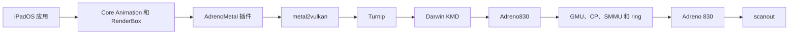

# Adreno830

先按[适配流程](/zh/porting/gpu)准备板级输入、修改源码、接入构建并逐步验证。

Adreno830 实现 SM8750 使用的 A830（Gen8，chip ID `0x44050001`）内核 GPU 接口：从冷启动给 GPU 上电，配置 GPU SMMU，启动 GMU 和命令处理器，并管理命令提交、内存、fence 和调频。驱动内的 SM8750 层（`platform/sm8750`）提供 GPU 上电、RPMh 投票、SCM 调用和 SoC 信息。设备通过同一个结构 `Adreno830Board` 提供签名固件、生成的设备树常量、保留内存和显示集成。

user client ABI 与 Adreno740 发布的相同：`NativeAdrenoABI.h` v2 逐字节一致，只有 `DeviceInfo` 的取值不同。两个驱动使用同一个 AdrenoMetal 插件。A830 的用户态改动见[构建](#build)一节。

首个设备是一加 13T（PKX110），系统为 iPadOS 17.7.11（21H461）。GPU 尚无硬件结果记录。

## 运行时链路



1. backboardd 找到 `AGXAccelerator` 服务（一个 `IOAcceleratorES`），按其 `MetalPluginName` 属性载入 AdrenoMetal 插件。插件发布 Metal 设备，管理 Metal 对象、编码器、IOSurface、event 和 fence。
2. metal2vulkan 把 AIR 翻译成 SPIR-V。Turnip 把 SPIR-V 经过 NIR 编译成 A830 IR3，并编码命令流。
3. Turnip 的 Darwin KMD 打开 Adreno830 的 `AGXDeviceUserClient`。Adreno830 管理 BO、GPU 地址、提交 ring、fence 和 SMMU context。
4. GMU 提交功耗票和频率票。CP 执行 ring 中的 IB 并写入 fence 值。
5. `sheng-fb-gpu=1` 时，插件通过同一 user client 的交接方法把每个合成帧复制到 scanout 缓冲，NativeMobileDisplay 提供并回收 swap。未设置时由 NativeMobileDisplay 用 CPU 复制。

## 启动阶段

`pagani-gpu=1` 时，Stage7Probe 在显示 late probe 的末尾调用设备的 `pagani_gpu_start()`，设备再同步调用一次 `adreno830_start()`，早于 launchd 启动。编排器依次执行下列阶段：

| 阶段 | 状态行名 | 工作 |
| --- | --- | --- |
| S0 | `INPUTS` | 板级结构、固件长度与 SHA-256、cmd-db、SMEM socinfo（SoC 618）、速度档熔丝、档位表 |
| S1 | `POWER` | 主机 CX 和 MX 票、GPU 上电（GDSC、PLL、时钟）、可选的 AOSS QMP 消息 |
| S2 | `SECCX` | SCM `GPU_INIT_REGS`、主机 CN0 和 DDR 票 |
| S3 | `SMMU` | SMMU 预检、GMU context（CB2）、GPU context（CB0）、LPAC 流、BO 池、aperture 调用 |
| S4 | `FWMEM` | GMU 内存与镜像、SQE 和 AQE、ring、memptrs 与上电恢复表 |
| S5 | `GMU-HFI` | GMU 冷启动、HFI 启动消息、`OOB_GPU`、确认 GX 已上电 |
| S6 | `CP` | Gen8 硬件初始化、微码基址、ring、`CP_ME_INIT` |
| S7 | `ZAP` | 经 PAS 13 装载 ZAP 镜像、退出安全模式 |
| S8 | `FENCE` | fence（设计配置下接 GPU 中断 332）、GMU always-on 计时器、自检写入 |
| S9 | `METAL` | `NativeAdrenoGpu` 与分阶段装载的 `AGXAccelerator` 服务 |
| S10 | `DCVS` | 电源状态机、恢复和 DCVS 线程 |

失败时停在所在阶段，记录步骤、原因码、IOReturn 和寄存器。驱动随后不发布任何服务，桌面保持 CPU 呈现。`pagani-gpu-stop=N` 在阶段 N 之后停下。

状态块 `adreno830_status` 供 BootProgress 叠加层的状态行（`pagani-gpu-status`）使用，S9 之后还写到 `NativeAdrenoGpu` 的注册表属性 `Adreno830Status`。第 0 行有以下几种形式：

| 第 0 行 | 含义 |
| --- | --- |
| `GPU S<stage>.<step> <name> FAIL <ioreturn> <register>=<value> r<reason>` | 该阶段失败 |
| `GPU S<stage> <name> STOP ok <ms>ms` | 之前各阶段全部通过，按 `pagani-gpu-stop` 停下 |
| `GPU RUN <MHz>M b<busy%> g<level>/b<bus> s<submits> f<faults> h<hangs>` | 驱动在运行 |

S0 接受启动配置之后，只要该行还有空间，第 0 行末尾会加上 `p1`（annibale）或 `p0`（设计）。`pagani-gpu-status=2` 时，annibale 配置的 S5 诊断行还显示 TCM 回读字数（`TCM`）、`GENERAL_11`（`G11`）和 RSC 状态（`RSC`）；做过 HFI 迟到排空后，S5 到 S8 的诊断行末尾显示 `L<m>/<a>/<e>`（消息数、迟到的应答数和迟到的 F2H 错误数）。

## 启动配置

`pagani-gpu-profile` 选择各阶段的执行方式：

| 取值 | 配置 | 行为 |
| --- | --- | --- |
| `1`（默认） | annibale | 凡是 13T 没有自己实测的地方，沿用 HackiOS 的 REDMI K90（annibale）移植在同一 SoC、同一 GMU 固件上于 XNU 下跑通的序列 |
| `0` | 设计 | 保留由 Linux 和 KGSL 推出的设计默认值 |

两种配置都保留 13T 上的实测值：GPU 上电与 PLL 序列、主机 CX/MX 与 DDR 票、SCM `GPU_INIT_REGS` 调用。两者都由主机写 ring 提交，未实现 GMU 硬件调度。

| 方面 | annibale 配置 | 设计配置 |
| --- | --- | --- |
| 档位 | HFI 表只有 160、222、342 MHz，不带 ACD，首个投票 160 MHz，未给 `pagani-gpu-dcvs-max` 时 DCVS 上限 342 MHz | 11 个共有档位，最高 900 MHz，初始档 222 MHz，DCVS 上限 734 MHz |
| CX_MISC AHB 超时 | S1 中 hub 时钟到 200 MHz 后写入 | 只在 `pagani-gpu-ahbto=1` 时设置 |
| SMMU 全局寄存器 | sACR 和 sGFSR 只读 | 清除 sACR 的 `CACHE_LOCK`，写回 sGFSR |
| SMMU context | 采用 K90 的 SCTLR、TCR 和 MAIR 值，只给 CB0 写 ACTLR，每次映射和解除映射后按 ASID 失效，轮询故障状态 | 设计的 context 取值，小范围解除映射时逐页失效，挂故障中断 710 和 712 |
| GMU 启动 | 屏蔽中断并轮询，镜像各块写后回读，发现 RSC 处于睡眠时先唤醒，释放 CM3 前读取 `GENERAL_11`，不播种 AO 计数器 | 使用 GMU 中断 336 和 337，只有驱动自己让 RSC 睡眠过才唤醒，S4 播种 AO 计数器 |
| HFI | 启动等待 500 ms，不发 `GET_VALUE`，`FEATURE_CTRL` 应答必须为 0，带宽表 AB 为 0；命令失败、S6、S7 或 S8 失败以及判定挂死之后，再读 3 s GMU 迟到的消息 | 启动等待 100 ms，发送 `GET_VALUE(GMU_AB_VOTE)` |
| CP 启动 | K90 寄存器表（中断掩码为 0，不开 HWCG），严格检查指针与 `CP_SQE_CNTL`，SQE 启动前后新出现的 sGFSR 位和 GMU 故障都会让启动失败，200 ms 内空闲 | 设计寄存器表，指针只记录，2 s 内空闲 |
| ZAP 之后 | 不开启 HWCG，`OOB_GPU` 一直持有到下一次冷启动 | 开启 HWCG，清除 `OOB_GPU` |
| fence | 不接中断 332；轮询 fence，DCVS 线程每秒回收一次已完成的作业 | 接上中断 332，且必须成功 |

## 组件

| 组件 | 作用 |
| --- | --- |
| `drivers/AdrenoMetal` | Metal 前端、metal2vulkan、命令编码、IOSurface 和 scanout client |
| `drivers/Adreno830` | 启动阶段、GMU、HFI、CP、ZAP、SMMU、中断、fence、DCVS、恢复、user client、BO、VM、ring 和提交 |
| `drivers/Adreno830/platform/sm8750` | SM8750 GPU 上电、RPMh、SCM、SoC 信息、AOSS QMP、LLCC 和 TSENS |
| `kits/ArmSmmu4K` | 4 KiB live 页表、context 映像和 stream 类型；context 由 `A830Smmu` 编程 |
| `kits/AdrenoPM4` | ring 与 CP 启动用的 PM4 包 |
| `kits/Sm8750Platform` | 与触控投票共用的 RPMh DRV-2 锁 |
| `drivers/NativeMobileDisplay` | CPU 呈现、GPU scanout 交接（`NativeGOPPresenter`）和 DCVS 用的 vsync 钩子 |
| `drivers/BootProgress` | 叠加层上的 GPU 状态行 |
| 设备仓库 `package/PaganiGpuBoard.cpp` | 填写 `Adreno830Board`、解析启动参数、调用 `adreno830_start()` |

组件目录项 `Adreno830` 从本地检出构建（`--local-module driver:Adreno830=PATH`），仓库和所有者尚未确定。

## 板级输入

驱动自己不读设备树，也不读启动参数。设备仓库从自己的 DTS 和钉选的安卓运行时 DTB 生成 `package/PaganiGpuInputs.h`，`PaganiGpuBoard.cpp` 把这些值填进 `Adreno830Board`。

| 输入 | 一加 13T 取值 | 用途 |
| --- | --- | --- |
| `gen80000_gmu.bin` | 88896 字节 | GMU 镜像（S4、S5） |
| `gen80000_sqe.fw`、`gen80000_aqe.fw` | 111892 和 25340 字节 | CP 微码（S4、S6） |
| `gen80000_zap.mbn` | 12088 字节，设备签名 | 经 PAS 13 装载的 ZAP 镜像（S7） |
| GPU、GMU、GPUCC、GCC、CX_MISC 和 RSCC 窗口 | `0x3D00000`、`0x3D37000`、`0x3D90000`、`0x100000`、`0x3D9E000`、`0x3D50000` | 上电与寄存器访问 |
| GPU SMMU | `0x3DA0000`，SID 0（GPU）、1（LPAC）、5（GMU） | GPU 用 CB0，GMU 用 CB2 |
| 中断（INTID） | 332 GPU、112 CX host、336 HFI、337 GMU、706 与 710-713 SMMU、994 SCM 等待队列 | fence、故障和 SCM |
| apps RSC DRV-2 | `0x16520000` | 主机 ACTIVE 票：CX、MX、CN0 和 DDR |
| 速度档熔丝 | QFPROM `0x221C8000` + `0x138`，9 位 | 选择档位表 |
| 档位表 | `qcom,gpu-pwrlevel-bins` 的 6 组、11 个不超过 900 MHz 的共有档位、12 级 DDR | HFI 性能表和带宽表、DCVS |
| AOSS QMP | 消息区 `0xC300000` | 可选的 ACD 消息（`pagani-gpu-qmp`、`pagani-gpu-acd`） |

固件不进入 Git。设备构建脚本 `scripts/build-pagani-gpu.py` 从 `.cache/firmware/pkx110-gpu` 读取固件，按 `scripts/data/sm8750-gpu-inputs.json` 逐个校验长度和 SHA-256，再按页对齐内嵌。S0 会再次校验钉选值。

保留内存：

| 区域 | 地址与大小 | 用途 |
| --- | --- | --- |
| cmd-db | `0x81C60000`，`0x20000`，no-map | 投票用的 ARC 和 BCM 地址（S0） |
| SMEM | `0x81D00000`，`0x200000`，no-map | socinfo（S0） |
| GPU 微码 | `0x9B09A000`，`0x2000`，no-map | 交给 TZ 的 ZAP 区（S7） |
| BO 池 | 默认 512 MiB | 写合并的自有 BO；在 S3 预留，失败则减半重试，下限 64 MiB |

显示集成：

| 项目 | 行为 |
| --- | --- |
| scanout 交接 | `sheng-fb-gpu=1` 时创建 `NativeGOPPresenter`。user client 转发交接方法 `0x7000` 到 `0x7005`，并以内存类型 `0x5343` 映射 scanout 内存 |
| 刷新钩子 | NativeMobileDisplay 调用 `pagani_display_vsync`、`pagani_display_late` 和 `pagani_display_underrun`，供 DCVS 使用 |
| 状态行 | BootProgress 把 `adreno830_status` 的各行画在保留带里，CPU 复制跳过该带 |

## 启动参数

`pagani-gpu` 由 Stage7Probe 读取，之后它调用设备的 `pagani_gpu_start()`。其余名字由设备用 `Adreno830ParseKnobs` 解析：先按表的顺序解析 `Adreno830KnobTable`（`Adreno830Board.h`）中的各项，再解析 `pagani-gpu-pool`。每个给出的参数都会置一个标志位，阶段据此区分默认值和显式取值。下表按同样的顺序排列。

| 参数 | 默认 | 作用 |
| --- | --- | --- |
| `pagani-gpu=1` | 0 | 在显示的 late probe 中运行驱动 |
| `pagani-gpu-stop=N` | 不停 | 阶段 N 之后停下，不发布 |
| `pagani-gpu-status=0..3` | 1 | GPU 叠加层行：0 不画；1 一行；2 再加三行诊断；3 再加用户态报告行 |
| `pagani-gpu-async=1` | 0 | 在内核线程上启动，只用于内核调试 |
| `pagani-gpu-rails=0/1` | 1 | 主机 CX/MX 票：1 为 cmd-db 最高档，0 为实验用的 LOW_SVS |
| `pagani-gpu-ddr=L` | 11 | S2 起的主机 DDR 票档位 |
| `pagani-gpu-ddr-floor=L` | 等于 `pagani-gpu-ddr` | 首个 GMU 带宽票之后保留的主机 DDR 底线 |
| `pagani-gpu-actlr=0xNNN` | `0x303` | SMMU context 的 ACTLR |
| `pagani-gpu-coherent=0/1/2` | 由自检决定 | 一致性导入：0 关闭；1 只限 GPU 只读的导入；2 再加 cached-coherent 导入 |
| `pagani-gpu-dcvs=0/1` | 1 | 0 把 GMU 档固定在 `pagani-gpu-perf` |
| `pagani-gpu-dcvs-min=MHz`、`pagani-gpu-dcvs-max=MHz` | 160、734 | DCVS 频率上下限；未给 `pagani-gpu-dcvs-max` 时，annibale 配置不超过 342 MHz |
| `pagani-gpu-perf=G` | 2（222 MHz） | DCVS 关闭时的 GMU 档 |
| `pagani-gpu-llcc=0/1` | 0 | GPU 的 LLCC 切片 |
| `pagani-gpu-speedbin=0/1` | 0 | 1 按速度档熔丝选表，并开放 900 MHz 以上的档 |
| `pagani-gpu-acd=0/1` | 0 | ACD |
| `pagani-gpu-hfi=MASK` | 0 | S5 对照：bit 0 改用 Linux 的依赖票写法，bit 1 把 `START` 放到 `OOB_GPU` 之后 |
| `pagani-gpu-diag=1` | 0 | 失败后多记录一些寄存器 |
| `pagani-gpu-qmp=0/1` | 0 | S1 发送 AOSS QMP 的 ACD 消息 |
| `pagani-gpu-cohtest=1` | 0 | 一致性测试镜像：发布前运行 V9b 和 V9c |
| `pagani-gpu-va=2/4` | 4 | CB0 光圈（GiB）：4 时 render server 获得 1.5 GiB、三个客户端各 682 MiB；2 恢复 1 GiB 和 170 MiB 的窗口 |
| `pagani-gpu-slumber=0/1/2` | 0 | slumber：1 完全断电，2 保留 CX |
| `pagani-gpu-ifpc=0/1` | 0 | IFPC |
| `pagani-gpu-ahbto=0/1` | 0 | 每次 GMU 启动时开启 CX_AHB 超时检测 |
| `pagani-gpu-profile=0/1` | 1 | 启动配置：1 为 annibale，0 为设计 |
| `pagani-gpu-hwsched=0` | 0 | 留给 GMU 硬件调度；S0 拒绝其他取值 |
| `pagani-gpu-pool=MiB` | 512 | 写合并 BO 池 |

下列名字由共享代码固定：

| 参数 | 作用 |
| --- | --- |
| `sheng-gpu-addon=1` | 挂载 Data 种子中的插件文件 |
| `sheng-gpu-metal-opens=0` | 取消对每个插件进程可获得连接数的限制（默认 40） |
| `sheng-fb-gpu=1` | 开启 GPU scanout 交接 |

一加 13T 的 GPU 板级配置在 `[payload] kernel_args` 中传入 `pagani-gpu=1 sheng-gpu-addon=1 sheng-gpu-metal-opens=0 sheng-fb-gpu=1`。`--kernel-arg pagani-gpu=0` 得到 CPU 合成的镜像。

## 构建 {#build}

在 Adreno830 检出目录中逐文件做内核编译检查，并运行主机测试：

```sh
python3 scripts/build-adreno830.py --tree <tree> --out <dir> --only <source>
python3 tests/run-host-tests.py --unixnu ../UniXNU --firmware <firmware directory>
```

设备仓库选中 `Adreno830` 和 `AdrenoMetal`，设置 `CONFIG_XNU_NATIVE_ADRENO_ARCHIVE="{tree}/build/adreno830/libAdreno830.a"`，把 `com.apple.iokit.IOGPUFamily` 加入 prelink roots，并在 `[kernel] archives` 中列出 `component:Adreno830` 和 `build-pagani-gpu.py`。在 UniXNU 检出目录中构建内核：

```sh
./unixnu build kernel -D <device repository> --local-module driver:Adreno830=../Adreno830
```

组件脚本 `scripts/build-adreno830.py` 生成 `build/adreno830/libAdreno830.a`，设备脚本再追加 `PaganiGpuBoard` 和钉选的固件。Stage7Probe、BootProgress、NativeMobileDisplay、PaganiArmCpu 和 PaganiInput 中与 GPU 相关的钩子来自 UniXNU-Pagani-Drivers 检出；固定版本里缺少钩子的模块，各加一个 `--local-module driver:NAME=PATH`。

用户态针对 A830 那份 ABI 头文件构建。Turnip 需要 `patches/mesa/turnip-a8xx-backports.patch` 和 `turnip-darwin-kmd.patch` 中的 A830 改动，后者把 chip `0x44050001` 命名为 Adreno 830。AdrenoMetal 增加了按方向进行的 IOSurface 缓存维护（`SurfaceMaintenance.h`）和 `NativeAdrenoMetal.env` 读取（`OwnerEnvironment.h`）：

```sh
export UNIXNU_GPU_ABI_DIR=<Adreno830 checkout>
python3 scripts/build-turnip-darwin.py --target ios
python3 scripts/build-adreno-metal-plugin.py
python3 scripts/make-owner-trust-bundle.py
python3 scripts/add-gpu-plugin-data.py --publish --clients WidgetRenderer_Default,PosterBoard --env <env file> --prime-list <prime list> <seed>.dbrdisk <output>.dbrdisk
./unixnu payload -D <device repository> --data-ramdisk <output>.dbrdisk --owner-trust-cache build/adreno-metal-plugin/owner-trust.bundle
./unixnu bootimg -D <device repository>
```

13T 的加载器只接受 RAM 盘和 trust cache，所以插件放在 RAM Data 种子里。种子的卷 UUID 必须等于 `CONFIG_XNU_OWNER_DATA_VOLUME_UUID`。`--env` 写入 `NativeAdrenoMetal.env`；最初的 A830 镜像使用 `TU_DEBUG=sysmem,nocb`。插件、`adrenoprobed` 或 Turnip 重新构建后，要重做 owner trust 包和 payload。

主机检查：

```sh
python3 scripts/check-adreno-userspace-host.py
python3 scripts/test-gpu-inputs.py
```

前者在 UniXNU 中运行，后者在设备仓库中运行。

## 状态

| 步骤 | 结果 |
| --- | --- |
| 源码与主机测试 | S0 到 S10 各阶段已完成，主机测试通过 |
| 内核链接 | 归档已链入 13T 内核 |
| 硬件上的 S0 到 S10 | 尚无结果记录 |
| Metal 设备发现 | 尚无结果记录 |
| GPU 合成桌面 | 尚无结果记录 |

NativeMobileDisplay 的 CPU 呈现提速（写合并 scanout 映射、整行复制和映射缓存）已在 13T 上单独验证，它不使用 GPU。

## 相关

- [一加 13T](/zh/devices/oneplus13t)
- [Adreno740](/zh/drivers/adreno740)
- [AdrenoMetal](/zh/drivers/adreno-metal)
- [GPU 与 Metal 适配](/zh/porting/gpu)
- [XNU 驱动](/zh/drivers/xnu-drivers)
